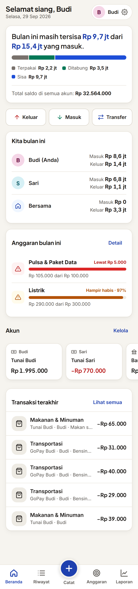
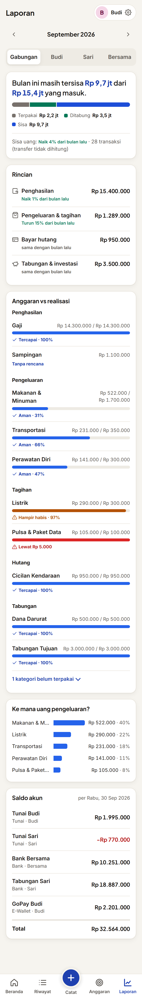
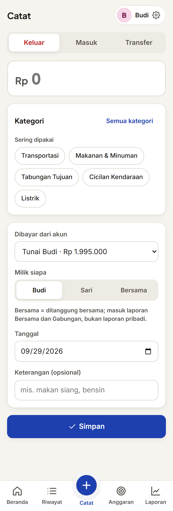
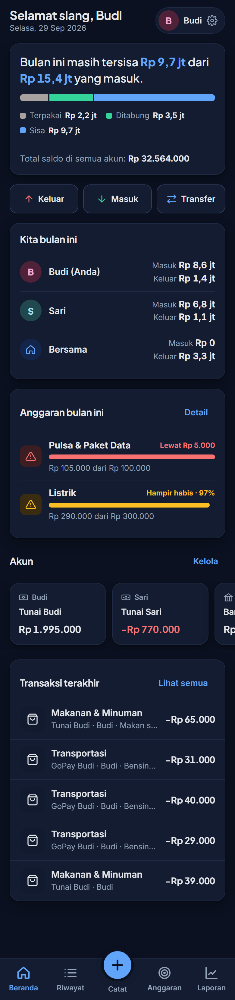

# Keuangan Kita

Aplikasi pencatat keuangan pribadi & keluarga di atas **Google Sheets + Google Apps Script** — gratis,
tanpa server, tanpa langganan. Mulai dipakai sendiri, lalu ajak pasangan atau keluarga: masing-masing mencatat
dari HP sendiri dengan PIN, tanpa perlu akun Google. **Semua data tersimpan di Spreadsheet milik Anda sendiri.**

| Beranda | Laporan | Catat | Mode gelap |
|---|---|---|---|
|  |  |  |  |

<sub>Tangkapan layar memakai data contoh fiktif.</sub>

**Fitur**
- Catat pemasukan, pengeluaran, dan transfer antar akun (tunai, bank, e-wallet) — cepat dari HP.
- Anggaran bulanan per kategori: pengeluaran sebagai *batas* (peringatan "Hampir habis"/"Lewat"),
  tabungan & cicilan sebagai *target* ("Tercapai"). Salin dari bulan lalu sekali ketuk.
- Laporan bulanan per orang, *Bersama*, dan gabungan, dengan perbandingan bulan lalu dan saldo tiap akun.
- Beranda yang bercerita: sisa uang bulan ini, kontribusi tiap anggota, anggaran yang perlu diperhatikan.
- **Bot Telegram** (opsional): ketik `25rb makan siang`, konfirmasi dengan satu ketukan.
- Pengelola + anggota, PIN tanpa akun Google, mode gelap, panduan awal untuk pemakai baru.
- Impor dari template spreadsheet "Budget Planner" lama.

Detail fitur: [`spek.md`](spek.md) · Arsitektur: [`docs/ARCHITECTURE.md`](docs/ARCHITECTURE.md) ·
Keamanan: [`docs/SECURITY.md`](docs/SECURITY.md)

## 1. Pasang tanpa terminal (disarankan)
Cukup akun Google (Gmail pribadi) dan browser di laptop. Sekitar 10 menit. Semua file yang ditempel ada di folder
[`dist/`](dist) — hanya **5 file**.

**A. Buat Spreadsheet & tempel kode**
1. Buka [sheets.new](https://sheets.new) → beri nama, mis. *Keuangan Kita*.
2. Menu **Ekstensi › Apps Script** (tab baru terbuka).
3. File `Code.gs` yang sudah ada: hapus isinya, tempel seluruh isi [`dist/Keuangan.gs`](dist/Keuangan.gs)
   (buka file di GitHub › tombol **Copy raw file**). Ubah nama file jadi `Keuangan` (opsional).
4. Tambah 3 file HTML: klik **＋ › HTML**, beri nama **persis** `Index`, `Css`, `Js` (tanpa `.html`),
   lalu tempel isi [`dist/Index.html`](dist/Index.html), [`dist/Css.html`](dist/Css.html), [`dist/Js.html`](dist/Js.html).
5. **Setelan proyek** (ikon roda gigi) › centang *Tampilkan file manifes "appsscript.json" di editor* →
   kembali ke Editor › buka `appsscript.json` › ganti seluruh isinya dengan [`dist/appsscript.json`](dist/appsscript.json).
6. Klik **Simpan** (ikon disket).

**B. Setup & terbitkan**
1. Kembali ke tab Spreadsheet → **muat ulang** halaman → muncul menu **Keuangan** (tunggu beberapa detik).
2. **Keuangan › Setup Awal** → Google meminta izin (*"Google hasn't verified this app"* muncul karena skrip buatan
   Anda sendiri: klik **Advanced › Go to … (unsafe)** › **Allow**) → jalankan **Setup Awal** lagi →
   ketik **nama Anda** → catat **PIN sementara** (hanya tampil sekali).
3. Di tab Apps Script: **Terapkan › Deployment baru** › jenis **Aplikasi web** ›
   *Jalankan sebagai*: **Saya**, *Yang memiliki akses*: **Siapa saja** › **Terapkan** → salin **URL aplikasi web**.
4. Buka URL itu di HP → pilih nama → PIN sementara → buat PIN baru. *Tambahkan ke layar utama* agar terasa seperti aplikasi.

> Akun Google Workspace (kantor/sekolah) sering melarang akses *Siapa saja*; pakai akun Gmail pribadi.

**Memperbarui ke versi terbaru:** tempel ulang 5 file dari `dist/` → Simpan → **Terapkan › Kelola deployment ›
Edit (ikon pensil) › Versi: Versi baru › Terapkan** (URL tetap sama) → jalankan **Keuangan › Setup Awal** sekali
(melengkapi kolom baru, tidak menimpa data).

## 1b. Pasang dengan clasp (untuk developer)
Butuh: [Node.js](https://nodejs.org) dan `npm i -g @google/clasp`.

1. `clasp login`, lalu dari folder ini: `clasp create --type sheets --title "Keuangan Kita" --rootDir .`
   (membuat Spreadsheet baru + proyek Apps Script, menulis `.clasp.json`).
   > `clasp create` menimpa `appsscript.json` dengan versi bawaan — kembalikan dengan `git checkout appsscript.json`.
2. `clasp push`
3. Buka Spreadsheet → muat ulang → menu **Keuangan › Setup Awal** → izinkan akses → jalankan sekali lagi →
   ketik **nama Anda** → catat **PIN sementara** (hanya tampil sekali).
4. Editor Apps Script: *Deploy › New deployment › Web app*, **Execute as: Me**, **Who has access: Anyone** → salin URL.
5. Buka URL di HP → masuk → ganti PIN. *Tambahkan ke layar utama* agar terasa seperti aplikasi.

> Akun Google Workspace (kantor/sekolah) sering melarang akses *Anyone*; pakai akun Gmail pribadi.

## 2. Menambah anggota
Di aplikasi: **Atur › Anggota › Tambah** → ketik nama → berikan PIN sementara + URL aplikasi kepada orang itu.
Hanya Pengelola (orang pertama) yang bisa menambah, me-reset PIN, atau menonaktifkan anggota.
Semua anggota melihat data yang sama; setiap orang hanya bisa mengubah transaksi yang ia catat sendiri.

## 3. Bot Telegram (opsional)
Catat lewat chat, misalnya `25rb makan siang` — setiap catatan dikonfirmasi dengan tombol sebelum disimpan.
1. Di Telegram, chat **@BotFather** › `/newbot` › ikuti langkahnya › salin **token**.
2. Spreadsheet › **Keuangan › Hubungkan Bot Telegram** › tempel token (pertama kali akan meminta izin akses internet).
   Deskripsi & menu perintah bot terpasang otomatis. Foto profil: @BotFather › `/setuserpic` › kirim [`docs/aset/logo-bot.png`](docs/aset/logo-bot.png).
3. Setiap anggota: aplikasi › **Atur › Telegram › Hubungkan** › ketuk **Buka di Telegram** › tekan **Mulai**
   (atau kirim `/hubung KODE` ke bot).
Perintah bot: `/saldo`, `/bulanini`, `/batal`, `/putus`, `/bantuan`. Isi chat juga tersimpan di server Telegram.
Salinan file butuh bot sendiri (satu bot hanya untuk satu Web App). Detail: [`docs/TELEGRAM.md`](docs/TELEGRAM.md).

## 3b. Impor dari template "Budget Planner" lama (opsional)
1. Tambahkan dulu anggota dengan nama yang sama seperti di nama tab `📋Transaksi <Nama>`.
2. Di file lama, klik kanan tab `⚙️Setting …` dan `📋Transaksi <Nama>` › *Salin ke › Spreadsheet yang ada* › pilih file ini.
3. **Keuangan › Impor dari Template Lama** (aman diulang). Cek hasilnya, lalu hapus tab salinan.

## 4. Update kode (clasp)
`clasp push` → *Deploy › Manage deployments › Edit › Version: New version* (URL tetap sama).
Setelah perubahan skema, jalankan **Setup Awal** lagi (menambah kolom yang kurang, tidak menimpa data).

## 5. Lupa PIN
- Anggota: minta Pengelola **Atur › Anggota › Reset PIN**.
- Pengelola: pemilik file menjalankan **Keuangan › Reset PIN** di Spreadsheet.

## 6. Pengembangan lokal
Tanpa akun Google — backend berjalan di emulator (`dev/emulator.js`) dengan data fiktif.
```bash
node dev/uji-e2e.js          # uji backend (wajib lulus)
node dev/bundel.js           # perbarui dist/ (salin-tempel) setelah mengubah kode — dicek oleh uji-e2e
node dev/server.js           # http://localhost:8788 — Budi 482913 (Pengelola), Sari 730519 (wajib ganti PIN)
DEMO=1 node dev/server.js    # hanya Pengelola, tanpa data contoh
node dev/screenshot.js out   # potret semua layar ukuran HP (butuh Chrome); TEMA=dark untuk mode gelap
```

## 7. Privasi
Repositori ini hanya berisi kode. Data keuangan ada di Spreadsheet Anda dan tidak pernah dikirim ke tempat lain
(kecuali isi chat bila Anda memakai bot Telegram). Jangan commit `.clasp.json` (sudah di `.gitignore`).

## Lisensi
[MIT](LICENSE) — bebas dipakai, diubah, dan dibagikan. Kontribusi & laporan masalah dipersilakan lewat Issues.

## 8. Checklist uji manual (di Google)
- [ ] Setup Awal menanyakan nama & menampilkan PIN sementara; menjalankan ulang tidak menggandakan.
- [ ] Buka URL di HP tanpa login Google → pilih nama → PIN sementara → wajib ganti PIN.
- [ ] PIN salah 5x → terkunci 15 menit. Tutup & buka lagi aplikasi → tetap masuk.
- [ ] Sendirian: tidak ada pilihan "milik siapa". Tambah anggota → PIN sementara → anggota bisa masuk; pilihan muncul.
- [ ] Anggota tidak melihat tombol kelola anggota. Nonaktifkan anggota → ia langsung keluar.
- [ ] Catat Keluar, Masuk, Transfer; "Urungkan"; saldo berubah.
- [ ] Riwayat: filter, cari; transaksi orang lain tidak bisa diubah. Ubah & batalkan transaksi sendiri.
- [ ] Laporan & Anggaran: angka cocok; transfer tidak dihitung; salin anggaran bulan lalu.
- [ ] Menu Jalankan Tes Logika: semua ✔. Tampilan HP & mode gelap.
